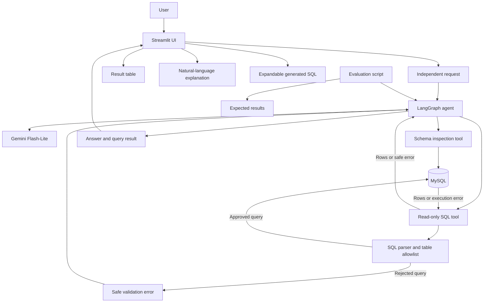

# Architecture Document
## LangGraph SQL Agent

**Status:** Proposed logical architecture  
**Version:** 1.0

## 1. Architecture principles

- Keep the first version small enough to understand.
- Use LangGraph tool calling as the agent control mechanism.
- Keep SQL validation outside the model's authority.
- Use live schema metadata alongside documented schema notes.
- Use read-only database credentials.
- Keep user interface, agent orchestration, database access, validation, and evaluation separated.
- Do not add Docker, a separate API server, RAG, vector storage, or multi-agent orchestration.

## 2. High-level component diagram

## 3. Request lifecycle

1. Streamlit accepts a new question.
2. The application constructs an independent request; previous chat turns are not included as agent context.
3. LangGraph invokes the model with the request and available tools.
4. If required, the schema tool reads live MySQL metadata. The documented schema explains the intended relationships; live metadata is authoritative for actual names.
5. Gemini chooses a tool call and generates SQL.
6. The SQL tool sends the candidate query to the validation component.
7. The validator parses the SQL, checks the allowed query policy and table allowlist, and rejects unsupported constructs.
8. If approved, the SQL tool executes through SQLAlchemy using a read-only MySQL account.
9. The tool returns bounded rows or a safe error.
10. For eligible execution errors, the agent may request a corrected query within the configured retry limit. The entire validation process runs again.
11. The agent produces a final explanation grounded in the returned data, or asks for clarification / returns a safe failure.
12. Streamlit displays the explanation, result table, and generated SQL in an expander.

## 4. Logical modules

| Module | Responsibility |
|---|---|
| `src/ui/` | Streamlit interaction and result rendering |
| `src/agent/` | LangGraph construction, state, and tool-call orchestration |
| `src/tools/` | Schema-inspection and read-only SQL tools |
| `src/database/` | SQLAlchemy engine and MySQL connection lifecycle |
| `src/validation/` | SQL parsing, table allowlist, query policy, and limits |
| `src/config/` | Environment loading and configuration validation |
| `evaluation/` | Test cases, runner, and comparison/reporting |

Exact filenames and public function signatures should be finalized before implementation.

## 5. Agent state and independence

The agent must not receive previous conversation messages as context. The visible Streamlit transcript is presentation state only.

A request may contain:
- Current user question.
- Schema context obtained for this request.
- Tool-call history within the current graph execution.
- Current query/result/error data.
- Retry count for the current request.
- Clarification status and response.

The exact state schema is TBD during implementation. State needed to complete one request is allowed; it must not become persistent cross-question memory.

## 6. Clarification behavior

When the intent is ambiguous, the agent asks a clarification question rather than guessing. Since cross-turn conversation history is disabled, the clarified request must be made self-contained for the next execution. The UI or request layer should explicitly combine the original question and the user's clarification into one request only when the user responds to a clarification prompt. It must not silently send the entire historical transcript.

This interaction detail needs careful implementation and a focused manual check.

## 7. Trust boundaries

- **LLM output is untrusted:** SQL generated by Gemini must be validated.
- **SQL validator is a gate:** The database tool cannot execute candidate SQL unless validation succeeds.
- **Database permissions are independent:** The runtime account cannot modify data even if application checks fail.
- **Tool errors are untrusted input:** Error text sent back to the model should be concise and sanitized.
- **Secrets remain local:** Credentials are loaded from `.env` and never included in model prompts or UI output.
- **Result data is bounded:** Query runtime and row count need explicit caps.

## 8. Failure paths

- Missing API key/model configuration → fail early with a clear configuration message.
- MySQL unavailable → show a safe connection error.
- Schema mismatch → use actual schema for query generation and surface a useful diagnostic.
- SQL parser rejection → do not execute; return a safe rejection.
- SQL execution error → optionally allow bounded correction for eligible errors.
- Retry exhaustion → return a friendly failure.
- Empty result set → treat as a successful query with no matching rows.
- Ambiguous intent → request clarification.
- LLM/API failure → return a safe failure without exposing secrets.

## 9. Deployment model

Local development only for the initial version:
- Python virtual environment.
- Locally installed MySQL.
- Local `.env`.
- Streamlit process.
- No Docker.

Deployment, authentication, and multi-user support are out of scope unless approved later.
